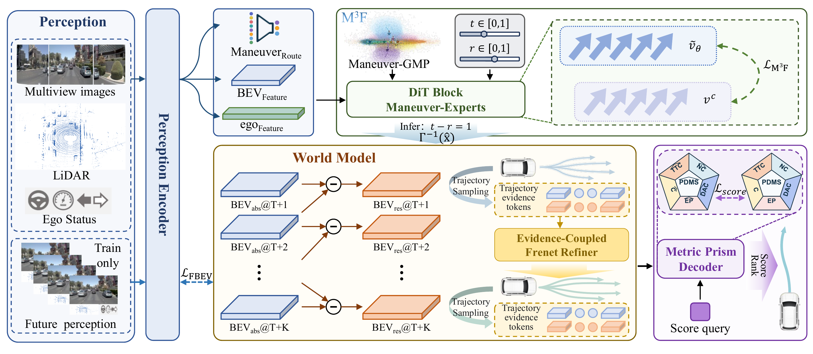

# ManeuverFlow

**Hypothesize, Verify, and Improve for End-to-End Autonomous Driving**

[](https://arxiv.org/abs/2610.13409)
[](LICENSE)
[](environment.yml)
[](requirements.txt)

[Paper](https://arxiv.org/abs/2610.13409) · [PDF](https://arxiv.org/pdf/2610.13409)

## Introduction

ManeuverFlow is an end-to-end autonomous-driving planner that generates diverse
maneuver-conditioned trajectories in one step, verifies them against current
and predicted future scene evidence, and refines promising candidates before
selection.

[](assets/maneuverflow_overview.pdf)

This repository provides the **ManeuverFlow-TF main model** for NAVSIM v1.

## Getting started

1. **[Installation](docs/install.md)** — Environment setup and checkpoint download.
2. **[Data preparation](docs/data.md)** — OpenScene data, nuPlan maps, and workspace setup.
3. **[Training](docs/train_eval.md#train-the-tf-model)** — Two-stage training, resume, and export.
4. **[Inference](docs/train_eval.md#evaluation-and-submission)** — Evaluate the model and create submissions.

[Pretrained checkpoint](checkpoints/README.md) · [Method and code map](docs/method.md)

## Acknowledgments and license

We thank [NAVSIM](https://github.com/autonomousvision/navsim),
[TransFuser](https://github.com/autonomousvision/transfuser), and
[MeanFuser](https://github.com/wjl2244/MeanFuser) for their open-source
contributions. The software is released under [Apache-2.0](LICENSE); datasets,
maps, and dependencies remain subject to their own terms.

## Citation

If you use ManeuverFlow in your research, please cite our paper:

```bibtex
@misc{wei2026maneuverflow,
  title         = {ManeuverFlow: Maneuver Hypothesis Generation with Future Evidence for Trajectory Evaluation and Refinement in End-to-End Autonomous Driving},
  author        = {Yuhao Wei and Yong Chen and Chen Yang and Yingchen Wang and Delin Ouyang and Lingfeng Qi and Qi Lan and Zhanhua Zhang and Jie Li and Guofa Li},
  year          = {2026},
  eprint        = {2610.13409},
  archivePrefix = {arXiv},
  primaryClass  = {cs.RO},
  url           = {https://arxiv.org/abs/2610.13409}
}
```
